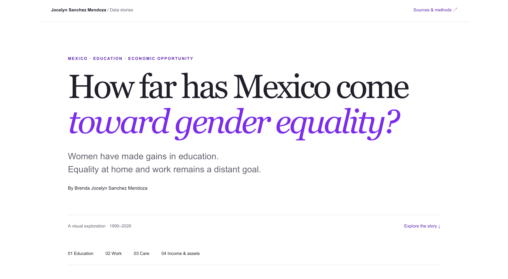

# How far has Mexico come toward gender equality?

*Women have made gains in education. Equality at home and at work remains a distant goal.*

By Brenda Jocelyn Sanchez Mendoza

## Description

This project explores how the lives of women in Mexico have changed over time and how gender gaps have evolved across different dimensions of social and economic life. Rather than focusing on a single measure of gender inequality, I provide a broader picture by examining trends in areas such as education, labor market participation and earnings, unpaid and care work, and asset ownership.

[Read the final visual narrative](https://jocelynsanchezm.github.io/data-viz-project/static-viz/)

## Data Sources

All statistical data come from Mexico’s National Institute of Statistics and Geography (INEGI).

- **Higher education, 1990–2020:** INEGI, *Sistema Integrado de Estadísticas sobre Violencia contra las Mujeres (SIESVIM)*, Table 618. Used to examine changes in higher education attainment by sex.  
  https://sc.inegi.org.mx/SIESVIM1/paginas/inicio.jsf

- **Education, labor force participation, and assets, 2025:** INEGI, *Encuesta Intercensal (EIC) 2025*, tabulations with a gender perspective. Used for schooling by age, national and state labor force participation, activities among people outside the labor force, vehicle availability, and dwelling ownership.  
  https://www.inegi.org.mx/programas/eic/2025/

- **Caregiving, 2022:** INEGI, *Encuesta Nacional para el Sistema de Cuidados (ENASIC) 2022*, basic tabulations. Used for primary caregivers, weekly caregiving hours, and reported economic and work impacts of caregiving.  
  https://www.inegi.org.mx/programas/enasic/2022/

- **Monthly labor income, Q2 2026:** INEGI, *Encuesta Nacional de Ocupación y Empleo (ENOE), población de 15 años y más*, second-quarter microdata, sociodemographic file (`ENOE_SDEMT226.csv`). Estimates use quarterly expansion weights and include employed people aged 15+ working 35–168 hours per week who report positive monthly labor income.  
  https://www.inegi.org.mx/programas/enoe/15ymas/#microdatos

### Geographic Data

- **Mexican state boundaries:** `mexicoHigh.json`, from the following GeoJSON repository. Used to draw the state map; statistical values come from INEGI.  
  https://github.com/angelnmara/geojson
