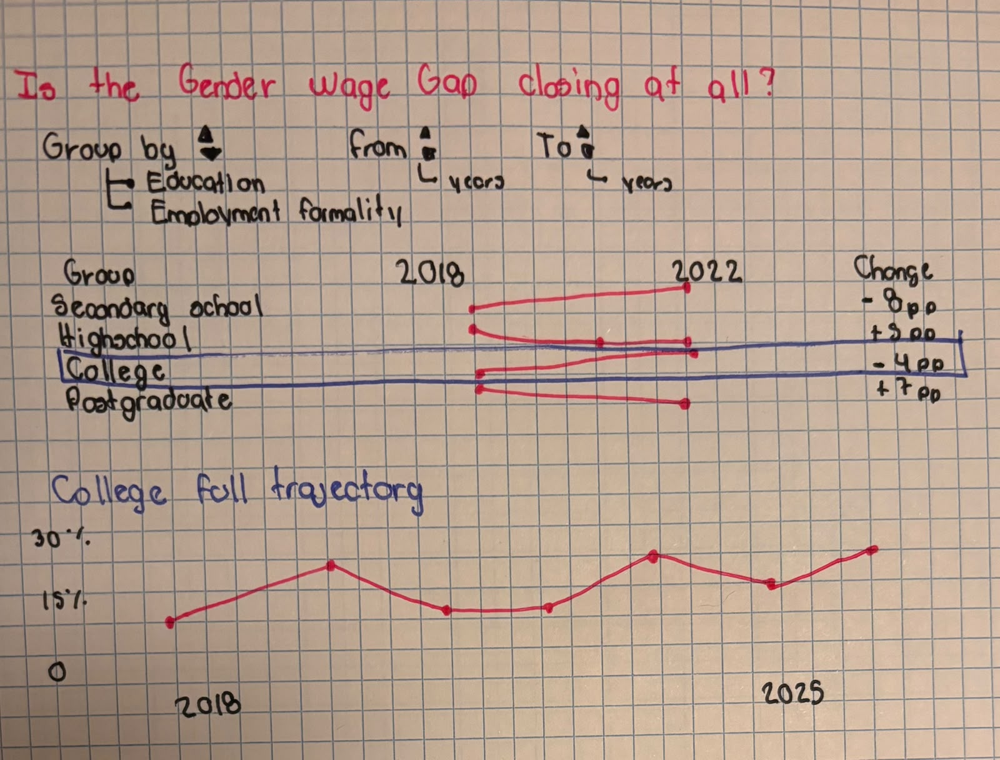

# Brenda Jocelyn Sanchez

## Description

This project builds on my static visualization project on gender inequality in Mexico by asking a new question: Is the gender wage gap closing at all, and for whom? I will use data from Mexico’s National Survey of Occupation and Employment (ENOE) to explore how the gap has changed over time and whether it has narrowed for some groups while persisting or widening for others.

The interactive visualization will let readers compare the wage gap between two selected years across groups. Selecting a group will reveal its full trajectory, so readers can see whether the change between those two years was gradual or whether the gap fluctuated along the way. I plan to start with educational attainment and formal versus informal employment, with the option to add parenthood status and full-time versus part-time work if the data support those comparisons.

To reduce the influence of seasonal variation, I will use the same survey quarter across years and check that the measures and group definitions are comparable over time.

## Technical Plan re: Option A/B/C/D

I plan to use **Option A (Large Interactive)** because the project centers on a single visualization with two linked views. Readers will select two years and compare the gender wage gap across groups using connected dots. Clicking on a group will reveal a line chart of its full time series, so readers can see whether the gap narrowed steadily, fluctuated, or widened again between the selected years. I will start with two ways to group workers: educational attainment and formal versus informal employment.

I plan to use **D3.js** to build the charts and link them to the year and group controls. I will use **Python and pandas** to clean the ENOE microdata and calculate weighted wage gaps using the same survey quarter across years. The page and its controls will be built with **HTML and CSS**.

I will draw on the next for inspiration:

- **IMCO’s wage gap monitor** shows how readers can explore Mexico’s wage gap across different groups. My project builds on that idea by making the change between two years the starting point and letting readers open the full trend for any group. [Brecha Salarial](https://imco.org.mx/monitor/mujeres-en-la-economia/?tab=brecha-salarial)

## Mockup

## Data Sources

{
include 1-3 data sources with the following,
you may re-use data sources from before or switch topics
}

### Data Source 1: {Name}

URL: [INEGI — ENOE microdata](https://www.inegi.org.mx/programas/enoe/15ymas/)

Size: Row and column counts are pending confirmation once the years, survey quarter, and variables are finalized.

I will use individual-level ENOE microdata from the same quarter across multiple years to examine how Mexico’s gender wage gap has changed over time. I will use survey weights to estimate the gap by educational attainment and by formal versus informal employment.

For my static project, I already explored the second quarter of 2026. I compared women’s and men’s average monthly labor income by educational attainment among workers aged 15 and older who worked at least 35 hours per week and reported positive labor income. For the interactive project, I will check that the variables and group definitions are comparable across years before combining the files.

## Questions

{Numbered list of questions for course staff, if any.}

1. IMCO already has an interactive tool that lets users explore Mexico’s gender wage gap across groups. My project would let readers compare those groups over time and see where the gap has narrowed, widened, or stayed about the same. Do you think making these trends the focus is enough to distinguish my project from IMCO’s tool?
