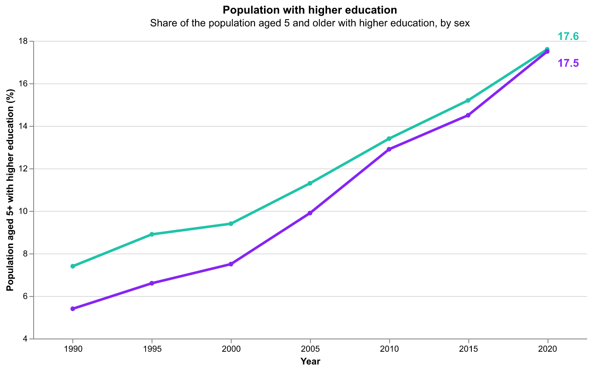
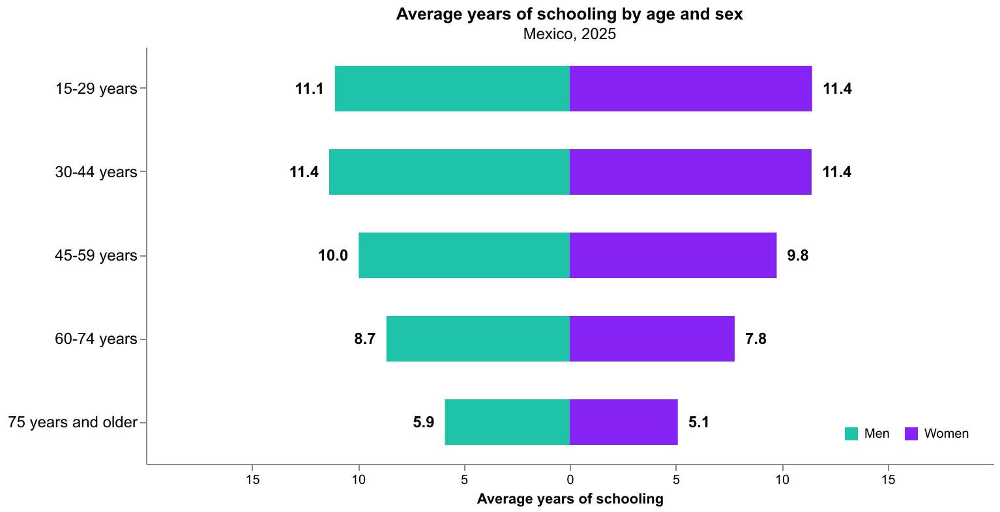
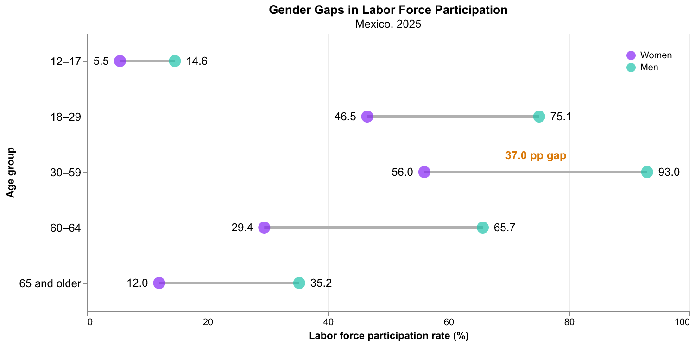
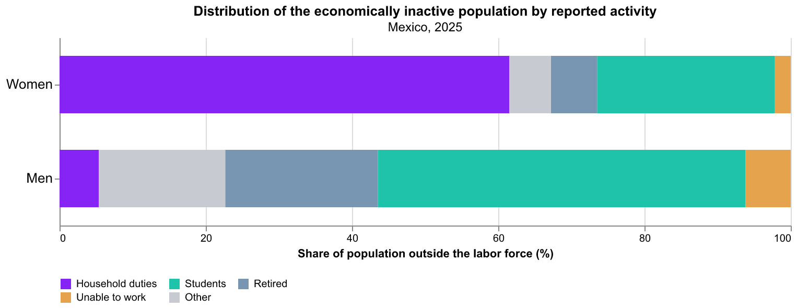
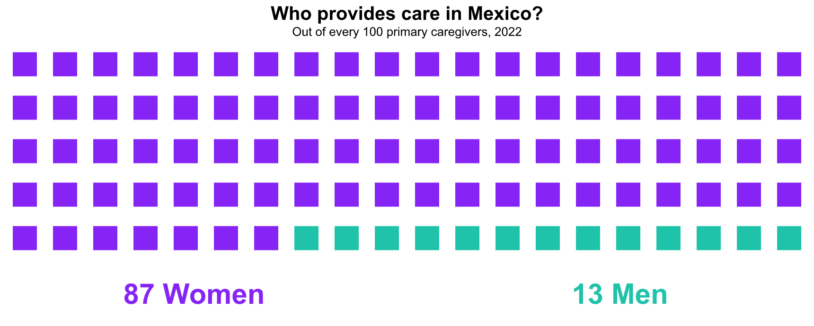
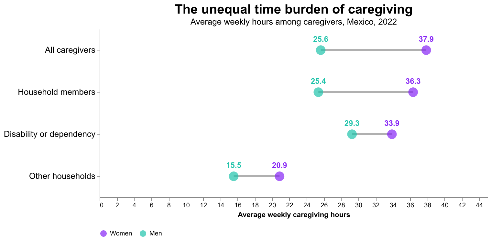
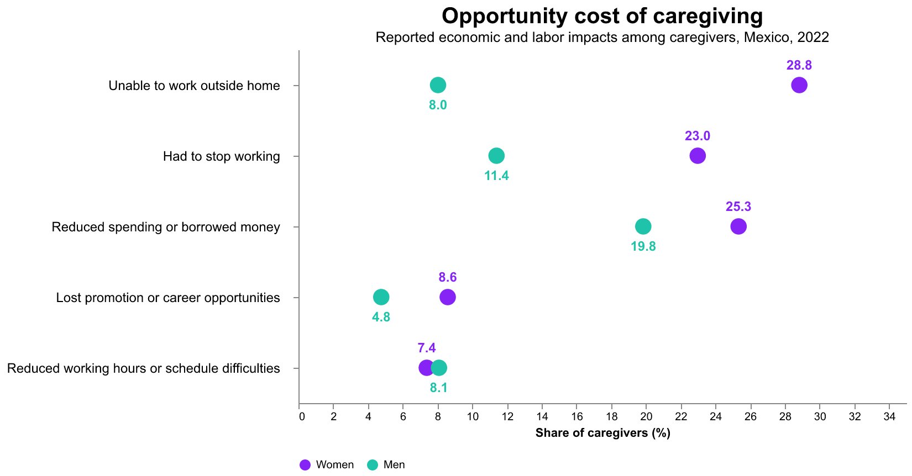
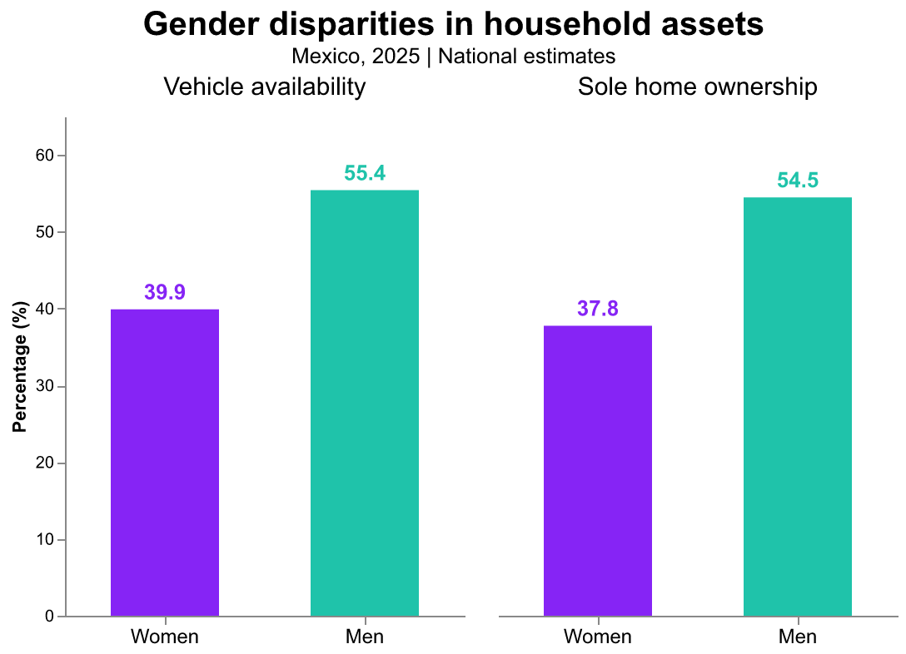

# What is it like to be a woman in Mexico and how has it changed across time?

Brenda Jocelyn Sanchez Mendoza

## What is your current goal? Has it changed since the proposal?

My overall goal remains the same: to explore what it is like to be a woman in Mexico and how gender inequalities have evolved over time. However, as I have explored the data, my focus has become more specific. I am particularly interested in understanding why improvements in women's educational attainment have not translated into equal labor market participation and economic opportunities.

I am now incorporating data on unpaid domestic work, caregiving responsibilities, and asset ownership to explore how inequalities across different dimensions of women's lives are interconnected. Rather than focusing exclusively on changes over time, I also want to provide a snapshot of the inequalities that persist today.

## Are there data challenges you are facing? Are you currently depending on mock data?

One of the main challenges I have encountered is data comparability. I am using several Mexican national surveys and census that differ in their geographic coverage and target populations. For example, some education indicators refer to people aged 5 and older, while others focus on those aged 15 and older. Additionally, changes in survey coverage across years make it difficult to assess trends consistently.

I am still exploring how to address these differences and determine which comparisons are valid. Where necessary, I plan to clearly acknowledge these limitations and avoid potentially misleading comparisons.

## Describe each of the provided images with 2-3 sentences to give the context and how it relates to your goal.

### Mexico at a Glance

Mexico has approximately 130.4 million inhabitants, of whom 67.7 million (51.9%) are women and 62.7 million (48.1%) are men.

Women have an older age structure than men. Their median age is 32.9 years, compared with 30.9 years for men. 

### Education

1. **Higher education**

*Source: INEGI, SIESVIM, Table 618.*

Between 1990 and 2020, the share of the population with higher education increased substantially for both women and men in Mexico. Over this period, the gender gap narrowed from 2.0 to just 0.1 percentage points, with women nearly reaching parity with men by 2020.

2. **Avarage years of schooling**

Source: INEGI, Encuesta Intercensal 2025, Table 11.

Average years of schooling vary considerably across age groups in Mexico. Women have slightly higher educational attainment among younger age groups, while men have an advantage among older adults. The gap is particularly pronounced among those aged 60 and older, suggesting that gender disparities in education are much smaller among younger generations.

### Labor Force Participation

3. **Labor force participation**

Labor force participation in Mexico remains substantially higher among men across all age groups. The largest gender gap occurs among adults aged 30–59, where 93.0% of men are economically active compared with only 56.0% of women—a difference of 37 percentage points. These disparities highlight that progress toward gender parity in education has not been accompanied by equivalent levels of economic participation.

Source: INEGI, Encuesta Intercensal 2025.

4. **Activities among inactive population**

Among Mexico's economically inactive population in 2025, 61.5% of women were dedicated to household duties, compared with only 5.4% of men. In contrast, students accounted for 50.3% of economically inactive men but only 24.3% of women. These differences highlight the unequal distribution of household responsibilities and suggest that unpaid domestic work may be an important barrier to women's participation in the labor market.

Source: INEGI, Encuesta Intercensal 2025, Tables 22 and 24.

### Care

5. **Caregiving**

Source: ENASIC 2022

87 out of every 100 primary caregivers in Mexico are women. This striking imbalance highlights how the responsibility of caring for children, older adults, and people with disabilities or care needs falls disproportionately on women, reinforcing traditional gender roles and inequalities in the distribution of unpaid care work.

6. **Time dedicated to caregiving**

Source: ENASIC 2022

Not only are women the vast majority of primary caregivers in Mexico, but they also spend significantly more time providing care. Among those who engage in caregiving, women dedicate an average of 37.9 hours per week, compared with 25.6 hours for men. This highlights a double inequality: women are more likely to assume caregiving responsibilities and spend more time fulfilling them.

7. **Oportunity cost of caregiving**

Caregiving responsibilities impose significant economic and labor-related costs, particularly on women. In Mexico, 28.8% of women who provide care to household members reported being unable to work outside the home, compared with only 8.0% of men. Similarly, 23.0% of women reported having to stop working, nearly twice the share of men (11.4%).

Women were also more likely to experience financial difficulties and missed career opportunities due to caregiving responsibilities. The only category in which men reported a slightly higher impact was reduced working hours or scheduling difficulties (8.1% versus 7.4%).

Overall, these findings suggest that caregiving responsibilities place a disproportionate burden on women's economic participation, potentially reinforcing existing gender inequalities in employment, income, and career advancement.

8. **Asset ownership**

Gender disparities are evident in both indicators. Vehicle availability is 15.5 percentage points higher in households with a male reference person, although this does not imply individual vehicle ownership. Similarly, among owner-occupied dwellings, men are more frequently identified as sole owners than women, with a 16.7 percentage point gap. These findings highlight gender differences in household characteristics and asset ownership.

### Salary Gap

9. **Salary gap**

I am working on this graph. 

Tip: The markdown syntax  will let you embed images directly, or you can number them and describe them by number in this file.

## What form do you envision your final narrative taking? (e.g. An article incorporating the images? A poster? An infographic?)

I envision the final narrative as a scrollable, data-driven article or blog post that guides readers through different dimensions of gender inequality in Mexico.